# КТ-7 - Выполнение тестовых заданий

Студент - Денисенко Даниил Евгеньевич  
Группа - 4п4.23 NET  
Дисциплина - ADO.NET  

### Задания

**Задание 1. Список студентов**

Разработать веб-API, которое позволяет управлять списком студентов: просматривать список студентов, добавлять нового студента, обновлять данные студента и удалять студента из списка.

**Задание 2. TMS**

Разработайте веб-API для системы управления задачами (Task Management System), позволяющую выполнять следующие операции:

- Создание задачи с указанием названия и описания.
- Получение списка всех задач.
- Обновление статуса задачи (например, новая, в работе, выполнена).
- Удаление задачи.

Ваше API должно поддерживать фильтрацию задач по статусу при выполнении запроса на получение списка.

**Задание 3. Бронирование **

Создайте веб-API для системы бронирования (например, отелей, авиабилетов, столов в ресторане), которое включает в себя следующие функции:

- Бронирование ресурса с указанием даты и времени.
- Просмотр доступных ресурсов для бронирования в заданный период времени.
- Отмена бронирования.
- Обновление деталей бронирования (например, изменение даты или времени).

API должно предусматривать возможность работы с различными типами ресурсов для бронирования, используя обобщенный подход.

Исходный материал: 3.8.КТ-7 Выполнение тестовых заданий.pptx

### Задание 1

Создал модель Student с полями Id, Name и Age и контроллер StudentsController
Добавил просмотр списка и отдельного студента, добавление, изменение и удаление
Данные хранятся в списке в памяти, как в примере из презентации

Главная страница с переходами к трём заданиям

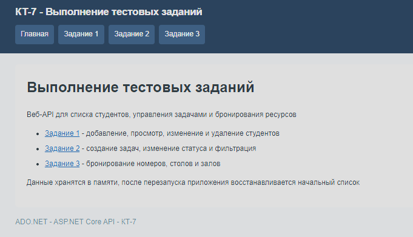

Список студентов с именами, возрастом и действиями для каждой записи

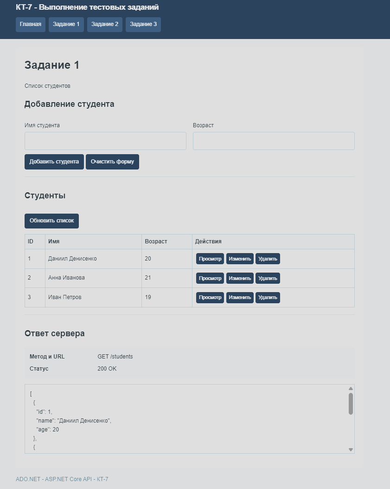

Новый студент добавлен в список, API возвращает статус 201

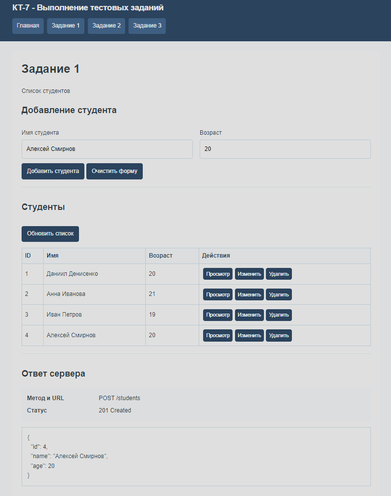

Просмотр отдельного студента по ID, API возвращает его данные

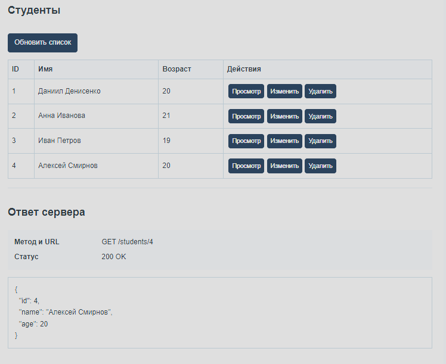

Изменены имя и возраст студента, новые данные отображаются в таблице

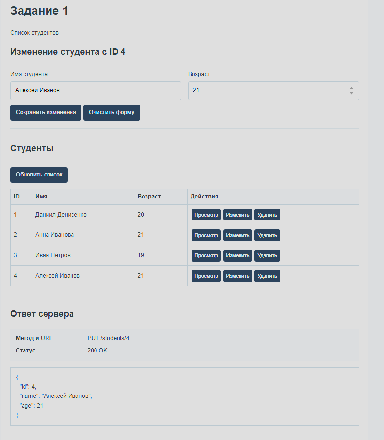

Студент удалён из списка, API возвращает статус 204

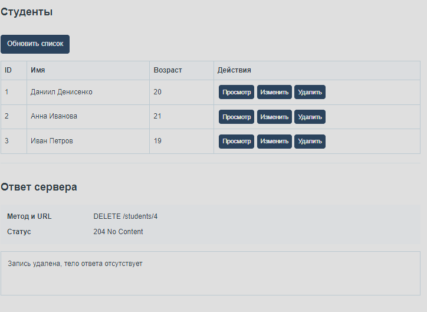

### Задание 2

Добавил создание задач с названием и описанием
Для задач можно менять статус, фильтровать список и удалять записи
Новая задача получает статус «Новая»

Созданная задача отображается вместе с остальными задачами, API возвращает статус 201

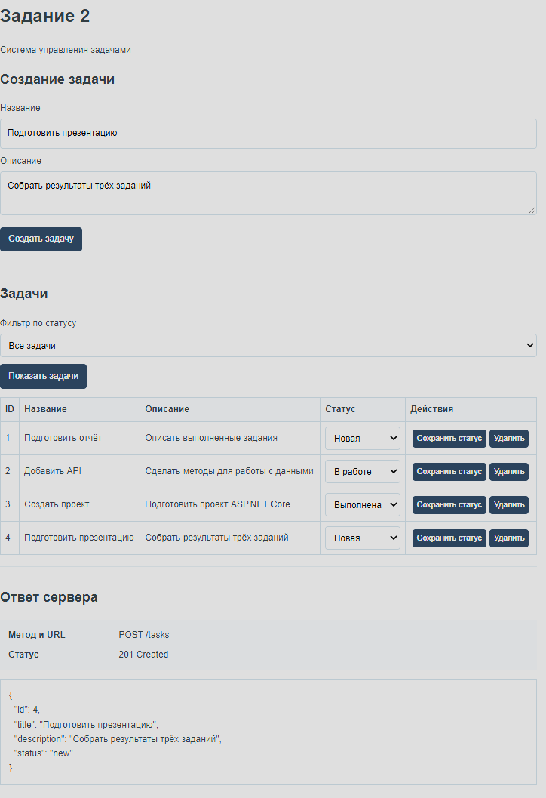

Статус задачи изменён на «В работе»

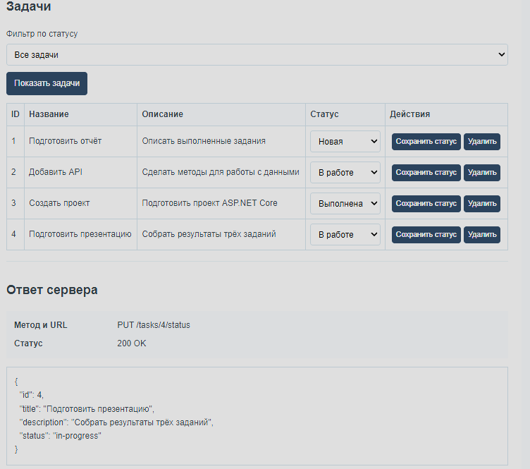

Фильтр возвращает только задачи со статусом «В работе»

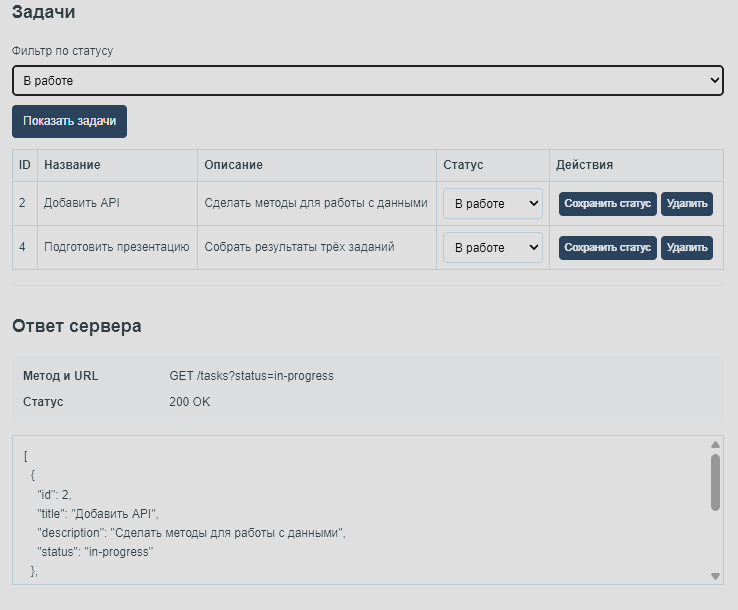

Задача удалена, остальные записи остались в списке

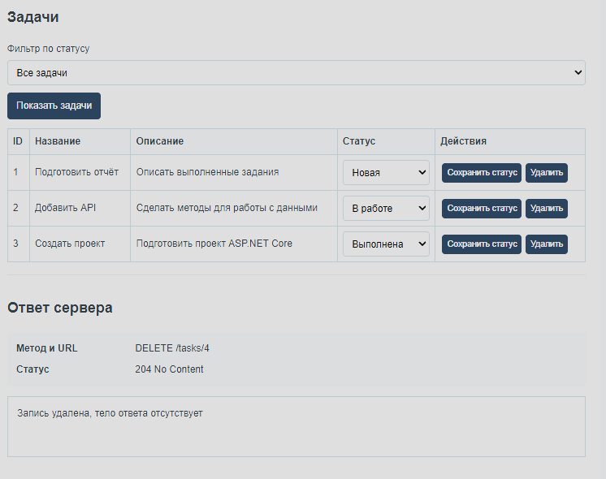

### Задание 3

Сделал общую модель Resource для номеров, столов и залов
Добавил поиск свободных ресурсов, создание, изменение и отмену бронирований
Пересекающиеся бронирования одного ресурса запрещены

Поиск показывает свободные ресурсы разных типов за выбранный период

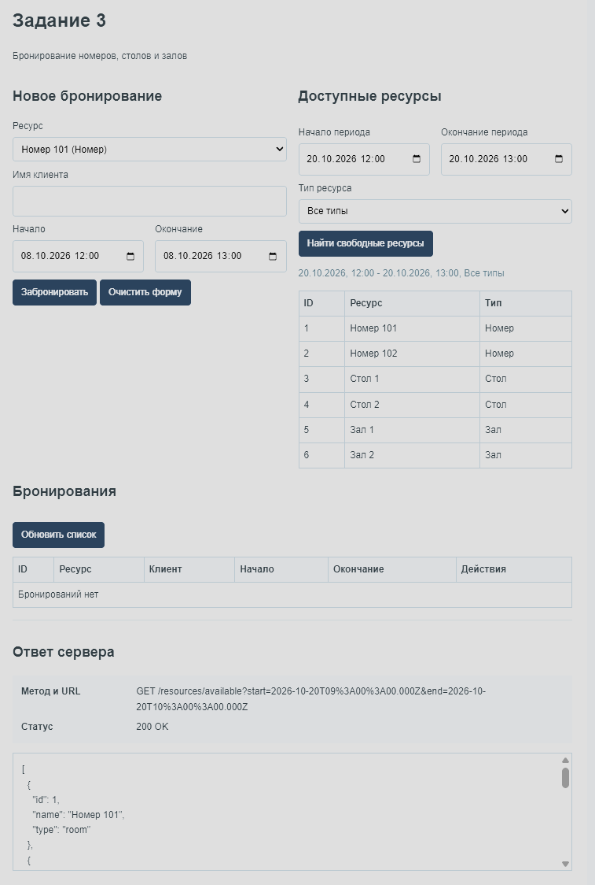

Создано бронирование номера с именем клиента, датой и временем

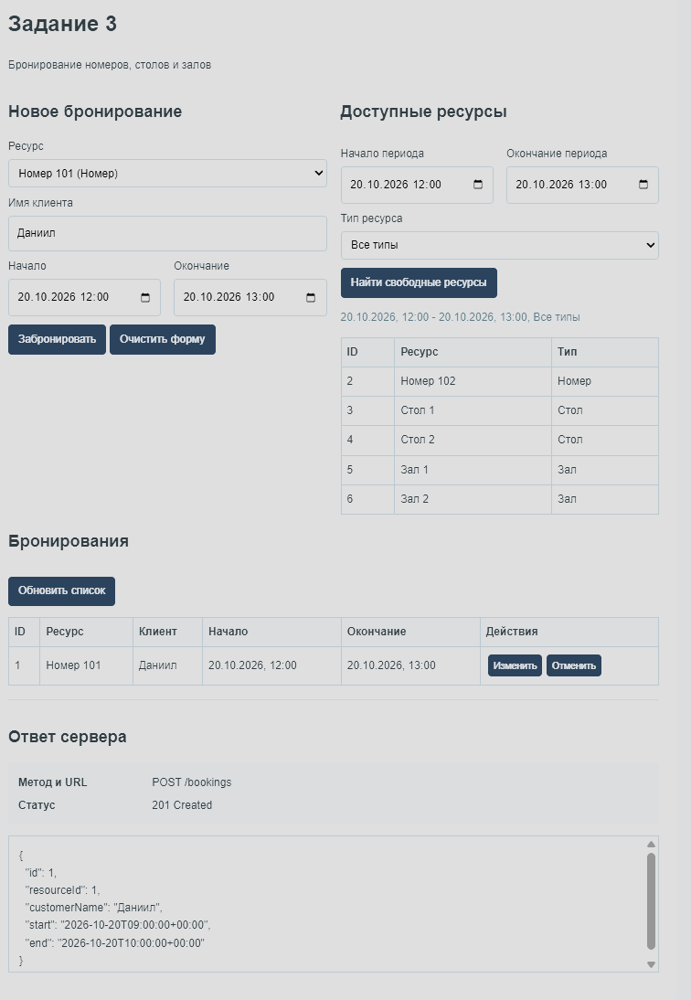

Повторное бронирование занятого номера возвращает статус 409, новая запись не создаётся

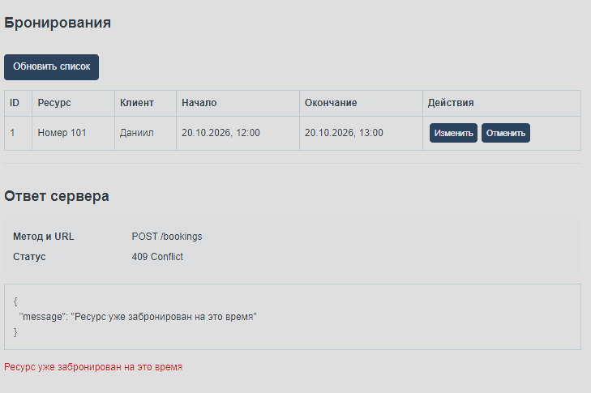

При поиске номеров занятый номер не попадает в список свободных

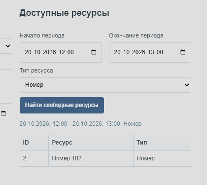

Время бронирования изменено, новые значения отображаются в списке

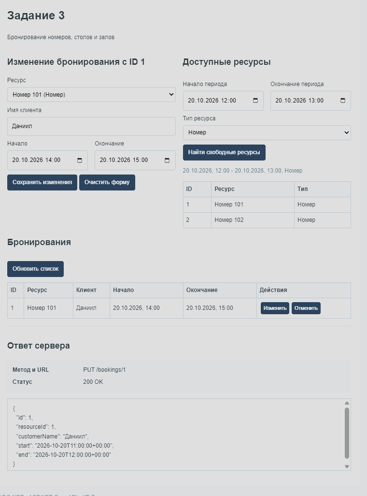

Номер и стол бронируются через одно API и отображаются в общем списке

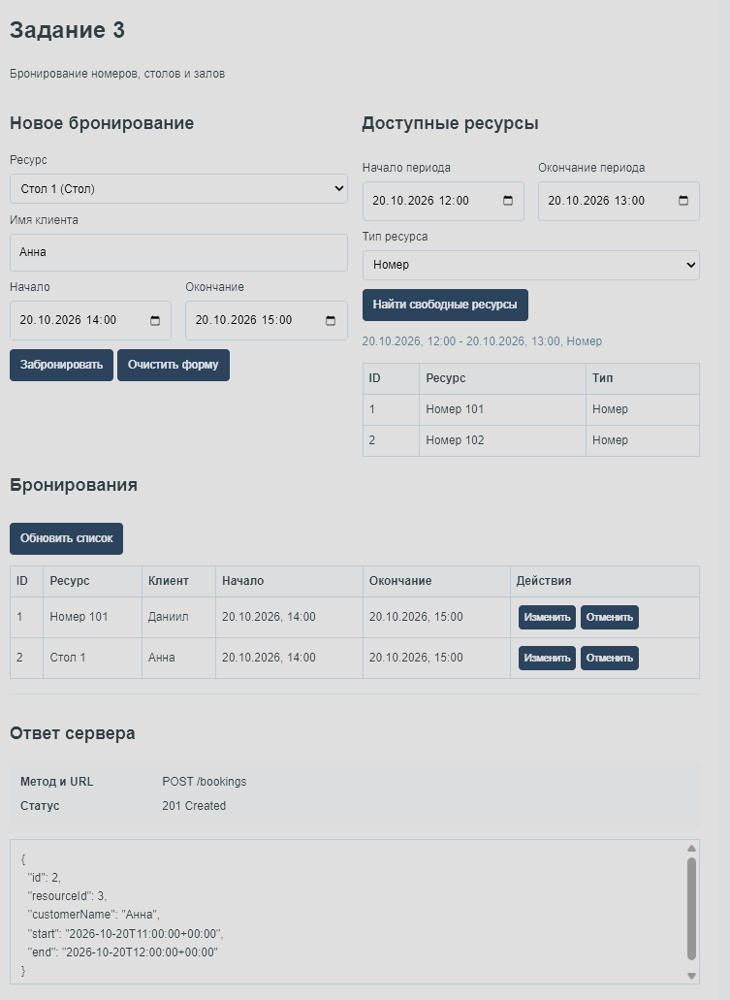

Бронирование номера отменено, номер снова доступен в выбранный период

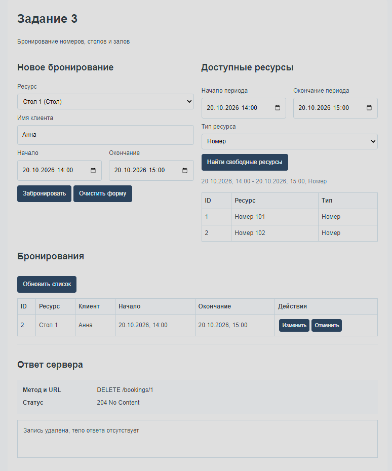
